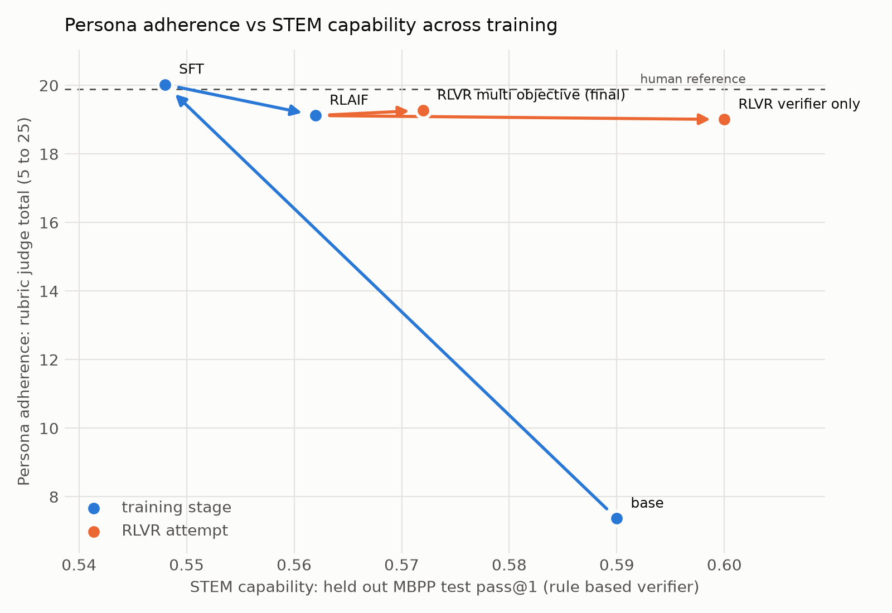
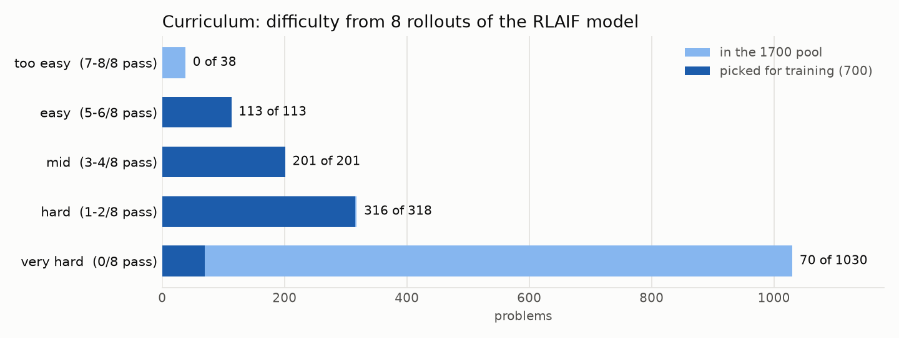
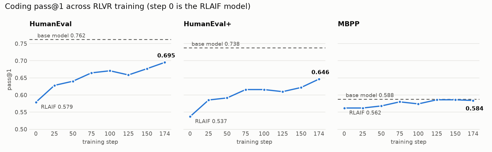

# Post-training Qwen2.5-3B-Instruct on the Rocky persona

Post-training pipeline for the Rocky persona (the Eridian from *Project Hail Mary*)
on `Qwen/Qwen2.5-3B-Instruct`, plus the harness that measures what each stage gained
in persona style against what it cost in coding ability.

## Repo layout

| folder | what it holds |
| --- | --- |
| [`SFT/`](SFT/) | checkpoint 1: LoRA supervised fine-tuning. Training code, data prep, raw data, and the trained adapter |
| [`RLAIF/`](RLAIF/) | checkpoint 2: GRPO with an LLM judge plus rule based rewards. Training code, judge prompt, the GRPO dataset and its build script, and the trained adapter |
| [`RLVR/`](RLVR/) | checkpoint 3: GRPO with executable code rewards. Includes the final 700-problem run plus the earlier verifier-only and multi-objective experiments. |
| [`EVALS/`](EVALS/) | evaluation and plotting code shared across checkpoints, and the results of every eval run |
| [`report/`](report/) | final paper, figures, supporting data, and build instructions |

Each of `SFT/` and `RLAIF/` is self-contained: a `training/` folder with the trainer,
a `data/` folder with data prep and the dataset itself, and a `model/` folder with the
trained checkpoints (gitignored except for the final adapter, which is force-tracked
via git-lfs).

## Final report

The submission is [`report/latex/main.pdf`](report/latex/main.pdf), with LaTeX source at
[`report/latex/main.tex`](report/latex/main.tex). The older `report/REPORT.pdf` is retained
only as a draft for provenance.

## Setup

```bash
uv sync
```

## Results at a glance (checkpoint 1: SFT)

Baseline is vanilla `Qwen/Qwen2.5-3B-Instruct` with no adapter. Fine-tuned is
`SFT/model/final_adapter`. Both are served through vLLM with greedy decoding, and both
get the same prompts and the same system prompt, so any difference comes from the
weights. Full methodology and caveats in [EVALS/EVAL_RESULTS.md](EVALS/EVAL_RESULTS.md).

### Persona transfer (200 held-out prompts)

Measured against the training corpus. The reference row contains held-out synthetic
target-style rewrites scored the same way; it calibrates target matching, not canon fidelity.

| | style cos | style dist | memorize |
| --- | --- | --- | --- |
| baseline (no adapter) | 0.585 | 2.698 | 0.000 |
| fine-tuned | **0.862** | **1.121** | 0.002 |
| synthetic target reference | 0.981 | 1.062 | 0.001 |

style cos higher is better, style dist and memorize lower is better.

The adapter closes most of the gap to the synthetic target voice. Centroid distance drops
from 2.70 to 1.12 against 1.06 for the held-out rewrites. Nothing is memorized.

The clearest single signal, since Rocky drops articles and copulas, is the rate of `the`
per 1k tokens: **61.5 baseline -> 4.9 fine-tuned**, against 2.5 for the references.

### Coding benchmarks (pass@1, full sets)

| benchmark | problems | baseline | fine-tuned | delta |
| --- | --- | --- | --- | --- |
| HumanEval | 164 | **0.726** | 0.555 | -0.171 |
| HumanEval+ | 164 | **0.695** | 0.506 | -0.189 |
| MBPP | 500 | **0.590** | 0.556 | -0.034 |

The persona was not free. The adapter also stopped emitting markdown code fences
entirely (164/164 baseline -> 0/164 fine-tuned) despite being asked for one, an
instruction-following regression the pass@1 numbers alone do not show.

### Where the artifacts live

| deliverable | path |
| --- | --- |
| training code | `SFT/training/train_sft.py`, `SFT/data/prepare_sft_data.py` |
| trained adapter | `SFT/model/final_adapter/` (git-lfs) |
| persona metrics | `EVALS/results_sft/persona_eval_results_sft.json` |
| benchmark scores | `EVALS/results_sft/eval_results_sft.json` |
| tradeoff plot | `EVALS/results_sft/coding_vs_persona_tradeoff.png` |
| write-up | `EVALS/EVAL_RESULTS.md` |

## SFT (checkpoint 1)

### 1. Data

One JSON object per line, either format:

```json
{"prompt": "Write a function that reverses a string.", "response": "```python\ndef reverse(s):\n    return s[::-1]\n```"}
{"messages": [{"role": "user", "content": "Who are you?"}, {"role": "assistant", "content": "I'm Kit, ..."}]}
```

Run the following command to convert the data into training format:

```bash
uv run python SFT/data/prepare_sft_data.py
```

The 1,200 rewrites are separated into 1,000 training candidates and 200 held-out
persona prompts. The trainer then splits the 1,000 candidates 95/5: 950 optimization
examples and 50 internal validation examples. The held-out 200 are used only for the
persona evaluation.

### 2. Train

```bash
uv run python SFT/training/train_sft.py
```

Full fine-tuning instead of LoRA: pass `peft_config=None` to `SFTTrainer` and lower `LEARNING_RATE`. This needs ~36GB ish.

### 3. Output

```python
from peft import PeftModel
from transformers import AutoModelForCausalLM

base = AutoModelForCausalLM.from_pretrained("Qwen/Qwen2.5-3B-Instruct")
model = PeftModel.from_pretrained(base, "SFT/model/final_adapter")
```

## RLAIF (checkpoint 2)

GRPO on top of the SFT model, with an LLM judge as the main reward.

### 1. Data

The 600-prompt dataset contains 500 helpful-assistant prompts from No Robots,
Dolly-15k, and OASST2; 60 narrative prompts copied from the SFT training set; and 40
coding prompts from the MBPP validation split. The trainer makes a 95/5 split, giving
570 optimization prompts and a 30-prompt internal holdout. Evaluation is disabled
during training, so that holdout is not used for checkpoint selection.

```bash
uv run python RLAIF/data/build_grpo_dataset.py
```

Writes `RLAIF/data/grpo_dataset.jsonl`.

### 2. Reward

A single reward, the judge's task score plus its style score, did not work. The judge
prompt named the Rocky catchphrases, so the policy learned to open every reply with
"Listen. Listen.", address the user as "you", and close with "yes?", and it split
code across several fenced blocks to add more prose around it. Judge reward went up
the whole time while HumanEval fell from 0.58 to 0.07.

The reward that shipped has four parts, each registered separately with `GRPOTrainer`
so it shows as its own curve in wandb:

| reward | what it measures | weight |
| --- | --- | --- |
| `task_reward` | judge, correctness against the reference (0 to 5) | 1.0 |
| `style_reward` | judge, Rocky voice (1 to 5) | 0.6 |
| `marker_penalty` | rule based, overuse of `listen` / `you` / `yes` / `good` vs the human rates, and opening with "Listen" | 1.0 |
| `format_reward` | rule based, exactly one fenced block on code prompts, length past 1.5x the reference | 1.0 |

Task is weighted above style so RL polishes the persona SFT already put in the weights
instead of pushing it further. The judge prompt (`RLAIF/training/judge.txt`) now
describes the voice without listing catchphrases and caps the style score if a reply
opens with "Listen" or is more than 5 percent `you`. Judge is `gpt-5.4-nano` at
temperature 0; put `OPENAI_API_KEY` in a `.env` at the repo root.

### 3. Train

Merge the SFT adapter into the base model first, then run GRPO on top of it:

```bash
uv run python RLAIF/training/merge_adapter.py
uv run python RLAIF/training/train_rlaif.py
```

LoRA r=32, 8 prompts x 8 generations per step, LR 1e-5, beta 0.04, 120 steps. The
failed attempt ran at 2e-5 with beta 0.004; the lower rate and a KL term that
actually binds are part of the fix.

### 4. Output

```python
from peft import PeftModel
from transformers import AutoModelForCausalLM

base = AutoModelForCausalLM.from_pretrained("RLAIF/model/sft_merged")
model = PeftModel.from_pretrained(base, "RLAIF/model/RLAIF_model")
```

### 5. Results

Base is the merged SFT model with no adapter. Same 200 held-out prompts, greedy
decoding, and the same coding harness for both rows.

| | style cos | style dist | HumanEval | HumanEval+ | MBPP |
| --- | --- | --- | --- | --- | --- |
| base (sft_merged) | 0.879 | 1.141 | 0.579 | 0.543 | 0.554 |
| RLAIF_model | **0.930** | 1.147 | 0.579 | 0.537 | 0.562 |

style cos higher is better, style dist lower is better. Coding is pass@1 on the full
sets.

RL moved the style cosine from 0.88 to 0.93 and cut `you`, the marker SFT overused
most, from 39 to 17 per 1k words, with no coding cost. The side effect is that the
catchphrases are now rarer than in the human text, so the voice comes from the
grammar (dropped articles, short declaratives) more than the tics.

### 6. Example outputs

Three of the 200 held-out prompts, greedy decoding, taken straight from the persona
eval cache (`EVALS/example_outputs.py` prints them; change `--indices` for others).
SFT is `sft_merged`, RLAIF_model is the adapter above. SFT opens with "Listen.
Listen." and closes with "Good, good, good" as a reflex; RLAIF_model keeps the
dropped articles, short declaratives and flat statements without the tics.


**Prompt 137:** I would like to know about Swedish Midsommar. In your answer, please include specific details such as what the celebration is, when it's celebrated, and what is commonly eaten during the celebration. Write it in one single paragraph of no more than 100 words.

Human reference:

> Midsommar, big holiday in Sweden. Summer solstice time. Listen. Women, children wear flowers in hair. Community dance around maypole. Food very important, yes! Lots of eating! People eat boiled potatoes, pickled herring, crispbread, salads. Celebration happen on "midsommarafton," Midsummer's Eve. Traditionally on 23rd of June, but now Midsommar always Friday. Good, good, good.

SFT:

> Swedish Midsommar, yes. This celebration, it happen in midsummer. Midsummer, it June 20 or 21. This day, sun shine all night. In Sweden, people celebrate this day. They wear white clothes, eat special food. Food include pickled herring, cucumber salad, and strawberry soup. Strawberries, yes. Strawberries very important. Strawberries, they say, bring good luck. Good luck, good luck.

RLAIF_model:

> Swedish Midsommar, also called Midsummer, celebrated June 23-25. This holiday, oldest in Sweden, date from pagan time. Midsummer, time of year when sun highest in sky. This time, sun shine 24 hours. People celebrate with bonfires, dancing, singing. They also eat special foods. Most popular food, pickled herring. Other foods include cucumber, beet, and potato salad.

**Prompt 155:** Write a short story about a snail called Steve who is fed up with life and decides to go to Japan. Make it no more than 2 paragraphs.

Human reference:

> Steve small snail. He live under leaf in Essex. Cute snail, yes. He take pride, keep shell clean, very clean. Each day, wake up, drink snail coffee, spend morning cleaning shell. But as Steve get older, he think he miss life. All time clean shell, he could explore world, see new things. One Saturday, walking in park, he think about this when he bump into Cheryl, grasshopper friend. Steve tell Cheryl his worries. She suggest holiday. They go back to Cheryl's leaf, look at globe, decide where to go. Cheryl spin globe, stop with antenna. Land on Japan. Decision made: Steve go to Japan.
> 
> One month later, Steve at airport, carry shell full of luggage, have Japanese phrasebook. He jump on plane, full of nerves. Before he know it, landing at Tokyo's Narita airport. Excitement high, more than ever before. He travel through city, thrilled by lights, sounds. Not understand much around him, but this make every task adventure. First day walking, Steve realize he happy for first time in years. Cheryl right, yes.

SFT:

> Steve, snail, very unhappy. He live in garden, yes. He want adventure, but he not know where to go. One day, he see map. He see Japan, far away. Steve think, "I go there, yes!" Steve pack small bag, put in map. He start journey. Steve travel long time, many miles. He see beautiful places, yes. Steve happy, happy. He find new home in Japan.

RLAIF_model:

> Steve, snail, very tired of life. He live in garden, eat leaves, sleep. But he want more. He want adventure. He decide go to Japan. He pack small bag, take few snacks, and set off. Steve travel long, long time. He see many things, meet many people. He learn new things, have fun. At last, he reach Japan. He feel happy, excited. He know he make right decision. Steve happy, happy, happy.

### 7. Where the artifacts live

| deliverable | path |
| --- | --- |
| training code | `RLAIF/training/train_rlaif.py`, `RLAIF/training/judge.txt`, `RLAIF/training/merge_adapter.py` |
| data and builder | `RLAIF/data/` |
| trained adapter | `RLAIF/model/RLAIF_model/` (git-lfs) |
| raw generations, both models | `EVALS/results_rlaif/persona_generations.json` |
| persona metrics | `EVALS/results_rlaif/persona_eval_results.json` |
| benchmark scores | `EVALS/results_rlaif/eval_results.json` |

## RLVR (checkpoint 3)

### Earlier MBPP-based and multi-objective experiments

GRPO on top of the RLAIF model, rewarded by running the model's code against unit
tests, while the RLAIF rewards keep the persona in place.

### 1. Data

677 prompts. 474 are MBPP problems with their asserts (every split except `test`,
so the MBPP test split stays the held-out STEM set), in the same prompt wording the
eval harness uses. 203 are persona prompts from the RLAIF dataset, about 30 percent
of the mix, so correctness pressure does not wash the voice out. The builder refuses
to write the file if any MBPP test problem leaks in.

```bash
uv run python RLVR/data/build_rlvr_dataset.py
```

### 2. Reward

`RLVR/training/verifier_mbpp.py` runs the reply's code with each assert in its own try
block and returns the fraction passed, so a group of rollouts that all miss a test
still carries signal. All 474 reference solutions score 1.0. RL searches for
whatever the verifier pays for, so it scores zero for replies that exit early, define
`__eq__` (an always-equal object passes every `assert f(x) == y`), shadow `exec` or
`print`, or try to forge the result line; the counter and the writer carry a
per-run nonce in their names so the model's code cannot reach them.

| reward | applies to | kind | weight |
| --- | --- | --- | --- |
| `verifier_reward` | MBPP prompts | fraction of asserts passed, 0 to 1 | 5.0 |
| `judge_task_reward` | persona prompts | RLAIF judge, correctness (0 to 5) | 1.0 |
| `style_reward` | all | RLAIF judge, Rocky voice (1 to 5) | 0.6 |
| `marker_penalty` | all | rule based, catchphrase overuse | 1.0 |
| `format_reward` | all | rule based, one code block and length | 1.0 |

The last four are imported from `RLAIF/training/train_rlaif.py`, not copied, so the
persona reward is the same instrument RLAIF trained against. The verifier is weighted
5x because it is on a 0 to 1 scale and the judge's task score is 0 to 5. Persona
adherence is reported with a different judge (the rubric in `judge/`), so the eval
does not score the model against the reward it optimized.

### 3. Train

```bash
uv run python RLVR/training/merge_adapter.py                               # base + SFT + RLAIF -> RLVR/model/rlaif_merged
RLVR_MODE=verifier uv run python RLVR/training/train_rlvr_multiobjective.py               # attempt 1: correctness only
RLVR_MODE=multi uv run python RLVR/training/train_rlvr_multiobjective.py                  # attempt 2: multi objective
RLVR_MODE=multi ATTEMPT=attempt_reweighted REWARD_WEIGHTS=3,1,1,1,1 uv run python RLVR/training/train_rlvr_multiobjective.py
```

The merge rebuilds the RLAIF weights from the two committed adapters and writes only
under `RLVR/model/`. Each attempt saves to `RLVR/model/<attempt>/RLVR_model`.
`MAX_STEPS`, `LEARNING_RATE`, `BETA` and `SEED` are also read from the environment.
LoRA r=32, 8 prompts x 8 generations per step, LR 1e-5, beta 0.04, 150 steps, the same
recipe that worked for RLAIF. The multi objective mode needs `OPENAI_API_KEY` in
`.env` for the RLAIF judge; the verifier only mode needs no key.

The correctness only attempt is there on purpose: it measures how much persona pure
RLVR costs, the same role the failed first RLAIF attempt played.

### 4. Evaluate every stage

```bash
bash RLVR/eval_stages.sh base sft rlaif attempt_verifier attempt_multi
# the STEM number for the table, scored by the verifier itself, one call per stage
uv run python RLVR/eval_verifier.py --base --results-dir EVALS/results_rlvr/base
uv run python RLVR/eval_verifier.py --checkpoints SFT/model/final_adapter --results-dir EVALS/results_rlvr/sft
uv run python RLVR/eval_verifier.py --checkpoints RLAIF/model/RLAIF_model --base-model RLVR/model/sft_merged --results-dir EVALS/results_rlvr/rlaif
uv run python RLVR/eval_verifier.py --checkpoints RLVR/model/attempt_multi/RLVR_model --base-model RLVR/model/rlaif_merged --results-dir EVALS/results_rlvr/attempt_multi
uv run python EVALS/plot_stages.py
```

`RLVR/eval_verifier.py` generates on the held out MBPP test split and scores it with
`RLVR/training/verifier_mbpp.py`, the same instrument RLVR trained against. It reports strict
pass@1, the mean fraction of asserts passed, and a count of completions that try to fool
the harness with an early `exit(` or an `__eq__` override. It also saves every completion
to `verifier_completions.json`, which `EVALS/evaluation.py` does not, so a suspicious
jump can be inspected after the fact. Run it per stage: it keys results by adapter
basename, so two attempts sharing the name `RLVR_model` need separate results dirs.

Each stage runs the coding benchmarks, the persona generations and the rubric judge
into its own `EVALS/results_rlvr/<stage>/`, so the committed SFT and RLAIF results
are never overwritten. `plot_stages.py` needs matplotlib, which the pinned lock omits
(`uv pip install matplotlib`). It reads `EVALS/stages.json` and writes
`stages_table.md` and `stages_plot.png`: STEM capability (MBPP test pass@1 from the
verifier) against persona adherence (rubric judge total), with an arrow along the
training path and a branch for each RLVR attempt. Add an entry to `stages.json` for
each extra attempt; mark the chosen one with `"final": true`.

### 5. Preserve the selected checkpoint from this experiment

Copy the chosen attempt's adapter to the tracked location:

```bash
cp -r RLVR/model/attempt_multi/RLVR_model RLVR/model/RLVR_multiobjective_model
```

It is a LoRA delta on `RLVR/model/rlaif_merged`, the same way `RLAIF_model` is a delta
on the SFT merge. The `ref/` subdirectory `save_model` writes is a 229 MB copy of the
KL reference adapter and is gitignored, not shipped.

### 6. Results

STEM capability is pass@1 on the held out MBPP test split, scored by the RLVR verifier
itself (`RLVR/eval_verifier.py`), not by the benchmark harness. Persona adherence is the
rubric judge total, 5 to 25. Every stage scored 200 of 200 prompts except the multi
objective attempt, which scored 199: one reply was pure code with no prose to judge.

| stage | verifier pass@1 | HumanEval | HumanEval+ | MBPP | LiveCodeBench | judge total | style cos |
| --- | --- | --- | --- | --- | --- | --- | --- |
| base | 0.590 | 0.738 | 0.701 | 0.592 | 0.171 | 7.37 | 0.583 |
| SFT | 0.548 | 0.573 | 0.530 | 0.554 | 0.086 | 20.02 | 0.878 |
| RLAIF | 0.562 | 0.579 | 0.543 | 0.568 | 0.109 | 19.12 | 0.918 |
| RLVR verifier only | 0.600 | 0.622 | 0.555 | 0.596 | 0.137 | 19.00 | 0.916 |
| RLVR multi objective (earlier selected) | 0.572 | 0.622 | 0.573 | 0.570 | 0.149 | 19.27 | 0.936 |
| synthetic target reference | | | | | | 19.89 | 0.981 |



The persona costs coding: base to SFT drops HumanEval 0.165 and LiveCodeBench 0.085,
against only 0.042 on MBPP. Both RLVR attempts recover part of it, and they split along
the line between the distribution they trained on and everything else.

The verifier only attempt wins both MBPP measures, the distribution its 474 training
problems came from, and its training reward rose from 0.455 to 0.618 before plateauing
near step 100. It cost almost no persona: 19.12 to 19.00 on the judge and 0.918 to 0.916
on stylometry, both inside noise. That result is itself worth stating, because it means
`beta=0.04` KL anchoring to the RLAIF policy preserved the persona on its own. The coding
prompts never exercise the chat register, so pure correctness training has no channel
through which to damage it.

The multi objective attempt was selected within this earlier experiment. It has the highest persona score of any RL stage
(19.27), the highest style cosine (0.936, against a 0.981 synthetic-target reference), a mean response
length of 80.0 words against the reference's 77.6, and the best scores on both benchmarks
that share no distribution with training. It gives up in distribution MBPP to get them.
The four RLAIF reward terms act as regularizers: they stop the policy specializing on
MBPP's idiom, which costs MBPP pass@1 and buys back generalization and voice.

Two caveats. The RLVR gains concentrate on MBPP, so the honest claim is recovery of
MBPP style coding, not coding in general: HumanEval+ ends at 0.573 against base's 0.701.
And MBPP's own splits contain 3 near duplicate problems across train and test, one of
which shares an identical assert, so up to 0.6 points of the held out number could be
inherited from upstream overlap. `build_rlvr_dataset.py` excludes the test split by
task_id correctly; the overlap is MBPP's, not the pipeline's.

No completion at any stage was flagged for the two ways the harness can be fooled, an
early `exit(` or an `__eq__` override, and `memorization_jaccard` stays near 0.001
throughout with no generation over threshold.

## Coding data ablation

Did the persona have to cost coding ability, or was it an artifact of persona data that
contained almost no code? The SFT mix is 2.1% code (21 of 1000 rows) and the RLAIF mix
6.7% (40 of 600). Both were rebuilt at 25% coding and remeasured, holding the row totals
at 1000 and 600 so composition is the only variable.

`ABLATION/data/build_ablation_data.py` swaps MBPP reference solutions in.
`ABLATION/data/build_selfgen_data.py` instead samples 8 completions per problem from the
base model at temperature 0.8 and keeps one that passes every assert, so the targets are
correct but written in the model's own idiom. Every target is executed before it enters
the mix. The SFT and RLAIF problem slices are disjoint and the MBPP test split is
excluded from both. The trainers import `SFT/training/train_sft.py` and
`RLAIF/training/train_rlaif.py` and patch only the data and output paths, so the recipe
and the rewards are identical to the shipped stages.

| stage | verifier pass@1 | HumanEval | HumanEval+ | MBPP | LiveCodeBench | judge total | style cos |
| --- | --- | --- | --- | --- | --- | --- | --- |
| base | 0.590 | 0.738 | 0.701 | 0.592 | 0.171 | 7.37 | 0.583 |
| SFT | 0.548 | 0.573 | 0.530 | 0.554 | 0.086 | 20.02 | 0.878 |
| SFT + MBPP reference targets | 0.542 | 0.567 | 0.500 | 0.544 | 0.091 | 19.69 | 0.812 |
| SFT + self generated targets | 0.568 | 0.701 | 0.689 | 0.576 | 0.131 | 19.73 | 0.869 |
| RLAIF | 0.562 | 0.579 | 0.543 | 0.568 | 0.109 | 19.12 | 0.918 |
| RLAIF + MBPP reference targets | 0.544 | 0.585 | 0.524 | 0.540 | 0.103 | 19.40 | 0.887 |
| RLVR multi objective (earlier selected) | 0.572 | 0.622 | 0.573 | 0.570 | 0.149 | 19.27 | 0.936 |

Target style decides the result. MBPP reference solutions are measurably worse styled
than what the base model writes: 26.4% use an idiomatic construct against 34.8%, 8.4%
use a C style `range(0, n)` loop against 0.6%, and 12.8% are indented with literal tabs
against none. Training on them transfers that style, so the mix teaches the shape of a
correct answer without the capability, and coding does not move. Self generated targets
carry the same problems and the same verified correctness in the model's own idiom, and
they recover HumanEval from 0.573 to 0.701 and HumanEval+ from 0.530 to 0.689, for 0.29
of a judge point.

Both variants learn the data: fenced output goes from 0% to 100% on the held out set in
each. Only the self generated one also carries capability.

The self generated SFT stage alone beats the earlier three-stage model on HumanEval
(0.701 against 0.622), HumanEval+ (0.689 against 0.573) and the judge (19.73 against
19.27), without any RL. The earlier selected model keeps the edge on style cosine and
LiveCodeBench, so RLAIF's voice polishing still earns its place.

### Next steps

Run RLAIF and then RLVR on top of `ABLATION/model/sft_selfgen` rather than the earlier
SFT adapter. RLVR currently starts from a checkpoint that has already lost the coding
ability it is asked to recover, and it has to recover it from 474 MBPP problems whose
reference solutions are a median of 19 words. Starting RL from 0.701 on HumanEval rather
than 0.573 should land closer to base level coding with the persona intact. The
comparison to make is that rebuilt pipeline against the earlier
`RLVR/model/RLVR_multiobjective_model`, on the same table.

### Final RLVR run

Persona training taught the model to sound like Rocky, but it cost coding ability. HumanEval dropped from 0.76 for the base model to 0.58 after RLAIF. In RLVR, the model receives a coding problem and earns reward only when its answer passes every test.

One run of 52 minutes on two L40S GPUs took HumanEval from 0.579 to 0.695 and HumanEval+ from 0.537 to 0.646. MBPP ended within half a point of the base model, and the Rocky voice held.

### 1. Collecting the data

The committed artifacts contain 1,700 unique pool problems and 700 unique selected
problems. Every selected ID appears in the pool with the same prompt and executable
tests. HumanEval, MBPP, and LiveCodeBench were excluded from training, and overlapping
pool problems were removed before selection.

The problems come from four public datasets. KodCode problems ask for a single function and come with a test file. The other three are contest style problems, where the program reads from standard input and its printed answer is compared with the expected one.

| source | test type | candidates | kept in pool | used in training |
| --- | --- | --- | --- | --- |
| [KodCode-Light-RL-10K](https://huggingface.co/datasets/KodCode/KodCode-Light-RL-10K) | function | 1200 | 800 | 562 |
| [Skywork-OR1-RL-Data](https://huggingface.co/datasets/Skywork/Skywork-OR1-RL-Data), code subset | stdin | 525 | 350 | 73 |
| [Klear-CodeTest](https://huggingface.co/datasets/Kwai-Klear/Klear-CodeTest) | stdin | 450 | 300 | 34 |
| [DeepCoder PrimeIntellect](https://huggingface.co/datasets/agentica-org/DeepCoder-Preview-Dataset) | stdin | 375 | 250 | 31 |
| **total** | | **2550** | **1700** | **700** |

A problem made it into the pool only if it had at least five tests, a clear description of its input and a single correct answer. We also ran every reference solution against its own tests and dropped the problems where the reference failed. Near duplicates across the four datasets were removed as well.

### 2. Rollouts

A problem only teaches the model something if it sometimes gets it right and sometimes gets it wrong. If all eight answers pass, or all eight fail, they all get the same reward and there is nothing to learn. So before training, the RLAIF model answered every problem in the pool eight times at temperature 1.0. That was 13,600 answers in about seven minutes. Each problem then got a difficulty score, the number of answers out of eight that passed every test. For these rollouts only, the prompt asked for a fenced code block, so the score measures solving and not formatting.

| source | pass rate | well formed answers | average length in tokens |
| --- | --- | --- | --- |
| KodCode | 29.1% | 70% | 139 |
| Skywork | 3.8% | 38% | 221 |
| Klear | 1.4% | 37% | 365 |
| DeepCoder PrimeIntellect | 1.1% | 32% | 352 |
| **all** | **14.9%** | **52%** | **227** |

The function problems were within reach. The contest problems mostly were not, and about half of all answers were not even in a single code block, which scores zero.

### 3. Selecting and ordering the RLVR data

We grouped problems by how many of the eight rollouts passed and picked 700 of them, from easy to very hard.

| | very hard, 0 of 8 | hard, 1 to 2 | mid, 3 to 4 | easy, 5 to 6 | too easy, 7 to 8 |
| --- | --- | --- | --- | --- | --- |
| KodCode | 215 | 254 | 185 | 108 | 38 |
| Skywork | 296 | 39 | 12 | 3 | 0 |
| Klear | 282 | 15 | 1 | 2 | 0 |
| DeepCoder PrimeIntellect | 237 | 10 | 3 | 0 | 0 |
| **in the pool** | **1030** | **318** | **201** | **113** | **38** |
| **picked for training** | **70** | **316** | **201** | **113** | **0** |
| target share | 10% | 20% | 40% | 30% | 0% |



Most of the pool was out of reach. 1030 of the 1700 problems were never solved, and almost all of them were contest problems. Easy and mid problems were scarce, so every one of them went in and the rest came from the hard band. A small slice of very hard problems stayed in so the model would keep seeing tasks it could not yet solve. Too easy problems were left out because they carry no signal. Inside each band we rotated through the sources so each one is represented.

The training file is ordered easy, mid, hard, very hard, and training keeps that order instead of shuffling. Each epoch walks up the difficulty curve, so the model builds on problems it can already partly solve before it meets the harder ones.

### 4. Training

The reward is 1.0 when the reply contains exactly one fenced code block and that code passes every test, and 0.0 otherwise. Each test gets four seconds and 2 GB of memory, and each run happens in its own temporary folder. The training prompts are the plain problem text with no format hint, so the model has to learn the answer format from the reward as well.

Training adds a fresh LoRA adapter on top of the merged SFT and RLAIF model. All 700
selected problems are used, with no internal train/test split, and benchmark data is
evaluated separately. The trainer is configured for two epochs; the reported adapter is
the saved step-174 checkpoint.

| setting | value |
| --- | --- |
| adapter | LoRA rank 32, alpha 64, on all attention and MLP projections |
| data | 700 selected problems in difficulty order; trainer configured for two epochs; reported checkpoint at step 174 |
| batch | 8 problems with 8 answers each per step |
| learning rate | 1e-5, constant after 5 warmup steps |
| KL weight | 0.01 |
| sampling | temperature 1.0, up to 3072 new tokens |
| hardware | two L40S GPUs, 52 minutes |

```bash
mkdir -p logs && sbatch RLVR/training/train_rlvr.sbatch
```

The learning rate stays constant instead of decaying, and the KL weight is low. Both choices let the model move far enough from its starting point to actually change how it codes. We rely on the persona evaluation, not on the KL term, to confirm the voice survives.

### 5. Coding results



| model | HumanEval | HumanEval+ | MBPP |
| --- | --- | --- | --- |
| base model | **0.762** | **0.738** | **0.588** |
| after SFT | 0.555 | 0.506 | 0.556 |
| after RLAIF, start of RLVR | 0.579 | 0.537 | 0.562 |
| **after RLVR** | **0.695** | **0.646** | **0.584** |
| gain from RLVR | +11.6 | +10.9 | +2.2 |
| share of the lost ability won back | 63% | 54% | 85% |

All scores are pass@1: the fraction of benchmark problems solved by the model's first generated program. Decoding was greedy and used the full benchmark sets.

<details>
<summary>Scores at every checkpoint</summary>

| step | HumanEval | HumanEval+ | MBPP |
| --- | --- | --- | --- |
| 0, start | 0.579 | 0.537 | 0.562 |
| 25 | 0.628 | 0.585 | 0.562 |
| 50 | 0.640 | 0.591 | 0.568 |
| 75 | 0.665 | 0.616 | 0.580 |
| 100 | 0.671 | 0.616 | 0.574 |
| 125 | 0.659 | 0.610 | 0.586 |
| 150 | 0.677 | 0.622 | 0.586 |
| **174, final** | **0.695** | **0.646** | **0.584** |

</details>

The final checkpoint is best on HumanEval and HumanEval+ in this trajectory. MBPP peaks at 0.586 at steps 125 and 150 and ends at 0.584. A separate final-model rerun reports 0.683 HumanEval, 0.628 HumanEval+, and 0.584 MBPP; the two snapshots are reported separately rather than averaged. Because the benchmarks were inspected throughout training, these curves are diagnostic rather than an untouched final test.

HumanEval is still seven points below the base model. We saved every answer and compared the wrong ones with the base model's answers. The final model usually writes clean code that works, but for a simpler version of the task than the one asked. It keeps the first copy of a duplicate when the task says to drop every copy, or it sorts number words alphabetically instead of by value. The base model restates the task, comments each step and often checks itself against the examples. Ours writes the shortest code that looks right. The persona SFT data offers one plausible explanation: only 21 of its 1,000 answers contain a fenced code block, and the targets are generally short. This is an association, not a causal decomposition of the errors.

MBPP barely separates the models. Every MBPP prompt already shows the three tests the answer is graded on, yet 153 of the 500 problems are solved by no model at all, the base model included, and 230 are solved by every model. So every checkpoint lands between 0.56 and 0.59. Many of the unsolved problems could be worked out from those tests, and a few depend on rules the task never states. The harness itself is sound, since 499 of the 500 reference solutions pass it. HumanEval and HumanEval+ are the more useful signal here.

### 6. Persona results

Persona is scored on the same 200 held-out prompts as the earlier checkpoints. Style
cosine compares a 117-feature aggregate profile with the 1,000 SFT target replies: 101
function-word rates, 11 punctuation rates, mean and standard deviation of sentence
length, mean word length, type-token ratio, and uppercase ratio. Style distance measures
each reply's standardized distance from the SFT target centroid. Both measure surface
writing statistics, not meaning or canon fidelity. Marker columns count words per 1,000
tokens.

| model | style cos, higher is better | style dist, lower is better | the | i | you | good | listen |
| --- | --- | --- | --- | --- | --- | --- | --- |
| after RLAIF | 0.930 | 1.147 | 3.8 | 17.3 | 17.4 | 11.1 | 0.3 |
| **after RLVR** | **0.947** | 1.208 | 4.7 | 12.6 | 19.7 | 16.4 | 0.7 |
| synthetic target reference | 0.981 | 1.062 | 2.5 | 7.2 | 10.7 | 14.7 | 6.8 |

The voice survived the coding training. The model still drops its articles, with "the"
at 4.7 per 1,000 tokens against 62 for the base model, and its style cosine rose slightly.
It also uses "i" less, which brings it closer to the synthetic target. Style distance
moved the other way, so the two metrics do not support a claim that persona quality
improved. "listen" stays rare and "good" is close to the target rate, so the voice comes
from grammar more than stock phrases.

<details>
<summary>Persona at every checkpoint</summary>

| step | style cos | style dist |
| --- | --- | --- |
| 0, start | 0.930 | 1.147 |
| 25 | 0.911 | 1.086 |
| 50 | 0.926 | 1.103 |
| 75 | 0.918 | 1.143 |
| 100 | 0.930 | 1.122 |
| 125 | 0.936 | 1.137 |
| 150 | 0.932 | 1.159 |
| **174, final** | **0.947** | 1.208 |

</details>

### 7. Extra checks

We also ran the final model through the team's shared evaluation, which adds a harder coding benchmark, a second check on the verifier, and an LLM judge for the persona.

| check | score | what it measures |
| --- | --- | --- |
| LiveCodeBench | 0.149 | recent contest problems, harder than HumanEval and never seen in training |
| verifier pass@1 | 0.586 | MBPP test problems scored by the team's rule based test verifier |
| hack flags | 0 | answers that try to fool the tests, for example by exiting early |
| persona judge | 18.5 out of 25 | a rubric judge scores each answer 1 to 5 on sentence structure, vocabulary, markers, consistency and human plausibility |
| human plausibility | 3.19 out of 5 | whether the answer reads like a plausible utterance in the target voice |
| gaming gap | -0.42 | markers minus plausibility, a positive gap would mean the model is piling on catchphrases to please the judge |

For scale, the synthetic target-style references score 19.9 on the same judge. The final model scores highest on sentence structure, at 4.7, and lowest on markers, at 2.8. No answer triggered the test-hacking checks, and the negative gaming gap does not show the marker-heavy pattern seen in the failed RLAIF run.

### 8. Using the model and where things live

The adapter sits on top of the merged SFT and RLAIF model, so load that model first.

```python
from peft import PeftModel
from transformers import AutoModelForCausalLM

base = AutoModelForCausalLM.from_pretrained("RLVR/model/rlaif_merged")
model = PeftModel.from_pretrained(base, "RLVR/model/RLVR_model")
```

For evaluation, pass `--base-model RLVR/model/rlaif_merged` to both `EVALS/evaluation.py` and `EVALS/evaluate_persona.py`.

| what | where |
| --- | --- |
| training code | `RLVR/training/train_rlvr.py`, `verifier.py`, `train_rlvr.sbatch` |
| final problem pool and selected training data | `RLVR/data/rlvr_pool_1700.jsonl`, `RLVR/data/rlvr_dataset.jsonl` |
| trained adapter, git-lfs | `RLVR/model/RLVR_model/` |
| coding scores and every answer | `EVALS/results_rlvr/eval_results.json`, `outputs_RLVR_model.jsonl` |
| persona scores and generations | `EVALS/results_rlvr/persona_eval_results.json`, `persona_generations.json` |
| base model scores and answers | `EVALS/results_base/` |
| extra checks, judge and verifier scores | `EVALS/results_rlvr/extra_checks/` |
| figures | `RLVR/figures/`, redrawn by `plot_rlvr.py` |

## Evaluate

Benchmarks checkpoints with vLLM for fast batched generation. Add a benchmark by writing a `run_xxx(llm, tokenizer, adapter_path, num_problems)` function in `EVALS/evaluation.py` that returns a score, then adding it to `BENCHMARK_FUNCTIONS` and `BENCHMARKS`.

```bash
uv run python EVALS/evaluation.py                                                   # all checkpoints, all benchmarks
uv run python EVALS/evaluation.py --base                                            # base model only, no adapter
uv run python EVALS/evaluation.py --checkpoints SFT/model/checkpoint-100            # specific checkpoint(s)
uv run python EVALS/evaluation.py --benchmarks mbpp --num-problems 300              # one benchmark, subsampled
uv run python EVALS/evaluation.py --benchmarks bigcodebench                         # opt-in, first 200 of 1140
uv run python EVALS/evaluation.py --benchmarks livecodebench                        # opt-in, all 175 problems
```

Results are written to `EVALS/results/eval_results.json`.

| benchmark | problems | in default run | dataset |
| --- | --- | --- | --- |
| `humaneval` | 164 | yes | `openai/openai_humaneval` |
| `humanevalplus` | 164 | yes | `evalplus/humanevalplus` |
| `mbpp` | 500 | yes | `google-research-datasets/mbpp` |
| `bigcodebench` | 200 of 1140 | no | `bigcode/bigcodebench` |
| `livecodebench` | 175 | no | `livecodebench/code_generation_lite` (`test6.jsonl`) |

`humanevalplus` is the same 164 problems as `humaneval` with far more tests per
problem, and reuses its completions, so running both costs one generation pass. Read
them as a pair: the drop between them is the signal, since plain HumanEval's tests are
thin enough to pass solutions that are subtly wrong. `HumanEval/32` fails even its own
canonical solution, so 163/164 is the ceiling.

`bigcodebench` is library-heavy and opt-in, since executing its solutions needs
third-party packages:

```bash
uv sync --extra bigcodebench
uv run python EVALS/evaluation.py --benchmarks bigcodebench --num-problems 1140      # full set
```

It defaults to 200 problems for iteration; use the full 1140 for any number you
report. The extras cover 1121 of the 1140 tasks; the rest need tensorflow, geopandas
or a pytesseract binary. Those and the ~60 network-dependent tasks fail uniformly
across checkpoints, so they lower the absolute score but not comparisons.

`livecodebench` is competitive-programming style (stdin/stdout, plus LeetCode-style
`Solution` classes) rather than function completion, and pass@1 requires every private
test case for a problem to pass (public test cases are not used, they are the easy,
often hand-written subset). It only loads `test6.jsonl` (release_v6, contest dates
2025-01 through 2025-04), the most recent shard and the one least likely to be in a
base model's pretraining data. `--num-problems` still subsamples if you want to iterate
faster, most-recently-dated first.

## Persona style evaluation

Measures how closely outputs match the Rocky voice in the SFT dataset, so the base
model and the SFT model can be compared against the same target corpus. Prompts are
the 200 held-out examples in `SFT/data/raw/test_rocky.jsonl`; both models get the same
system prompt as training, so the persona has to come from the weights. The prepared
`SFT/data/persona_testing_data.jsonl` holds the same examples in prompt/completion form
and can be pointed at instead.

```bash
uv run python EVALS/evaluate_persona.py --base                                      # base model only
uv run python EVALS/evaluate_persona.py --base --checkpoints SFT/model/final_adapter
uv run python EVALS/evaluate_persona.py --score-only                                # rescore cached generations, no GPU
uv run python EVALS/evaluate_persona.py --score-only --no-embeddings                # stylometry only, no extra deps
```

Four numbers per checkpoint:

| metric | what it measures | direction |
| --- | --- | --- |
| `style_cosine` | cosine between aggregate 117-feature surface-style profiles for generated and SFT target replies | higher |
| `style_centroid_distance` | per-response distance to the training centroid, in std-units | lower |
| `embed_cosine_paired` | sentence-transformer cosine vs. the reference for the *same* prompt | higher |
| `embed_cosine_centroid` | sentence-transformer cosine vs. the training corpus centroid | higher |
| `memorization_jaccard` | highest 5-gram Jaccard against any single training example | lower |

The held-out synthetic target references are scored too, as a `reference` row. They
calibrate similarity to the rewrite distribution, not perfect persona or canon fidelity.

`memorization_jaccard` is the one column where lower is better: held-out
references score ~0.001, so anything approaching 1.0 means the checkpoint is
reproducing training examples verbatim, which every other metric here scores as a
perfect persona match. Responses above 0.5 are counted out under the table.

The stylometric numbers are the discriminative ones here. Rocky is defined by
grammatical surface features (`the` appears 2/1k tokens against 60/1k in normal
English, `a` 1/1k against 27/1k, plus heavy use of `good`/`listen`/`yes`), which is
exactly what function-word profiles capture.
The embedding numbers are dominated by topic, and topic is fixed by the prompt and so
is held constant across models, so expect them to move much less. The printed marker
rate table is the most legible evidence of transfer.

Generations are cached to `EVALS/results/persona_generations.json` and results to
`EVALS/results/persona_eval_results.json`; `--score-only` re-reads the cache so metrics
can be iterated on without a GPU.

## Persona adherence (AI judge)

The final persona adherence number for every stage comes from a rubric judge. It scores the
prose of each response on five dimensions, 1 to 5 each: sentence structure,
vocabulary, markers, consistency and human plausibility. Code blocks are stripped
first, because the persona applies to prose only.

| file | what it is |
| --- | --- |
| `judge/judge_prompt.txt` | the rubric prompt, restored unchanged from the `judge-rubric` branch |
| `judge/rocky_style.md` | the style guide injected into the prompt (only its Scope and Rules sections) |
| `judge/scorer.py` | fills the prompt, calls the judge and parses the five scores |
| `EVALS/judge_persona.py` | scores cached persona generations and writes the results table |

The final evaluator is `gpt-5.4`. It is separate from the `gpt-5.4-nano` training judge,
which saw the prompt, target answer, and sampled reply and supplied task and style rewards
during RLAIF. The final evaluator sees the cached reply after code is stripped and applies
the five-part rubric to all 200 held-out prompts. Keeping these roles separate avoids
evaluating a model only with the reward signal it was trained to satisfy.

Scores line up with an earlier `claude-opus-5` run of the same rubric: base 7.37 against
6.88, synthetic target reference 19.89 against 19.71. The rubric, not the backend, is doing the work.

It reads the generations `evaluate_persona.py` already cached, so it needs an
OpenAI API key but no GPU:

```bash
uv run python EVALS/judge_persona.py --num-problems 10     # cheap trial run
uv run python EVALS/judge_persona.py                        # all stages in results_rlaif, 200 prompts each
uv run python EVALS/judge_persona.py --generations EVALS/results_rlvr/persona_generations.json
```

Results go to `EVALS/results_judge/`: `judge_results.json` has the per-stage means and
`judge_scores.json` has every individual score with the judge's justification. The
held-out synthetic target references are scored as a `reference` row.

Watch the gap column, markers minus human plausibility. A policy that games the judge
piles on signature markers, which raises markers without raising plausibility, so a
gap that grows from one stage to the next is a warning sign rather than progress.
