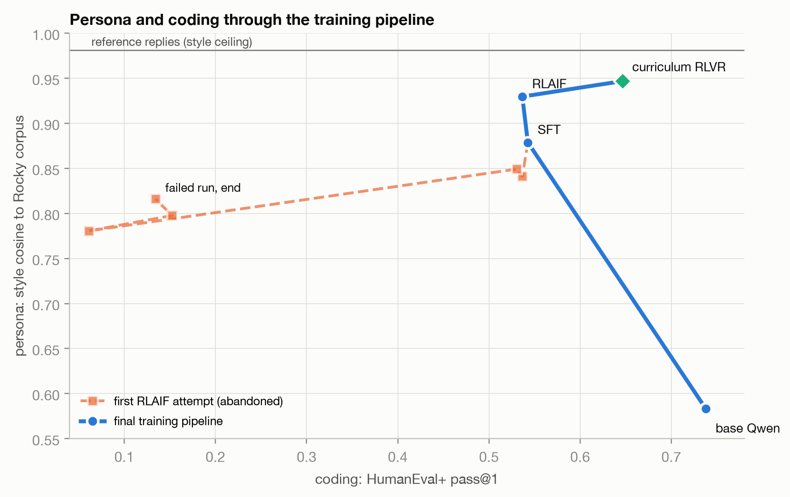
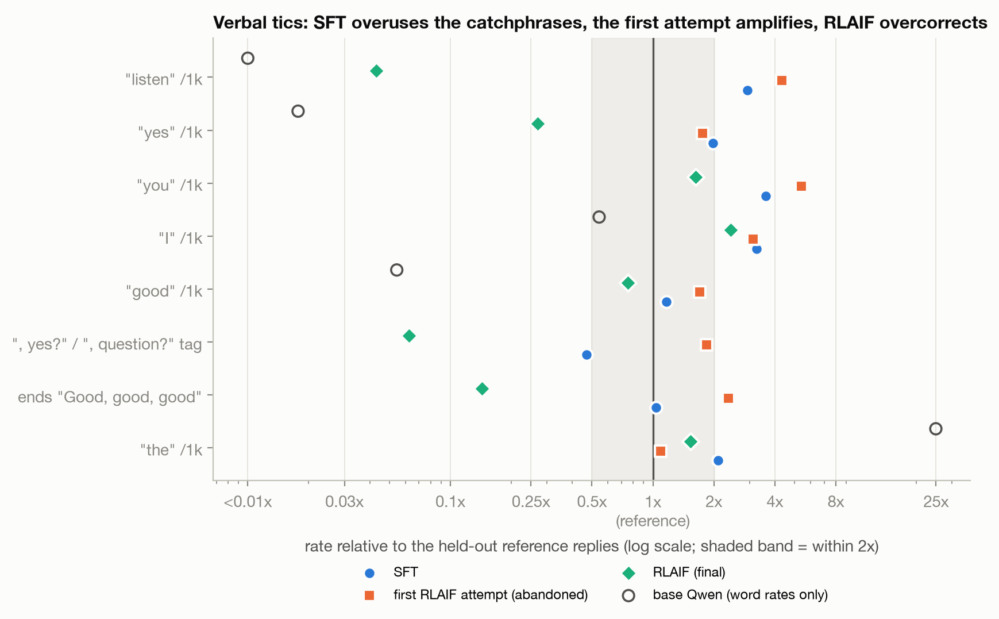
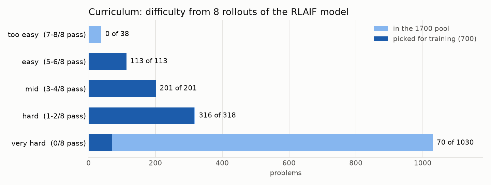
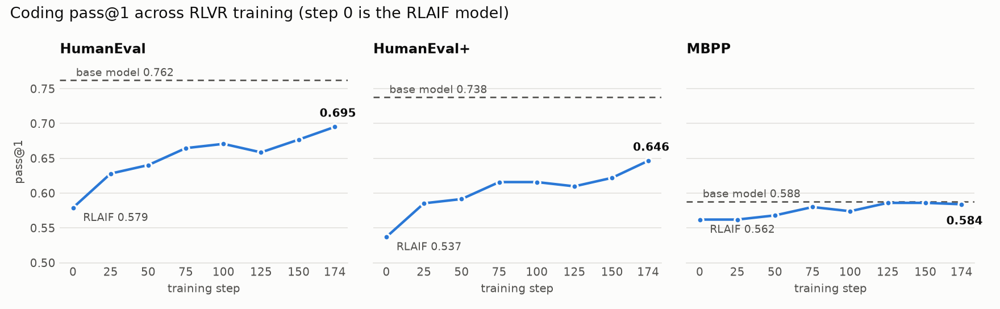
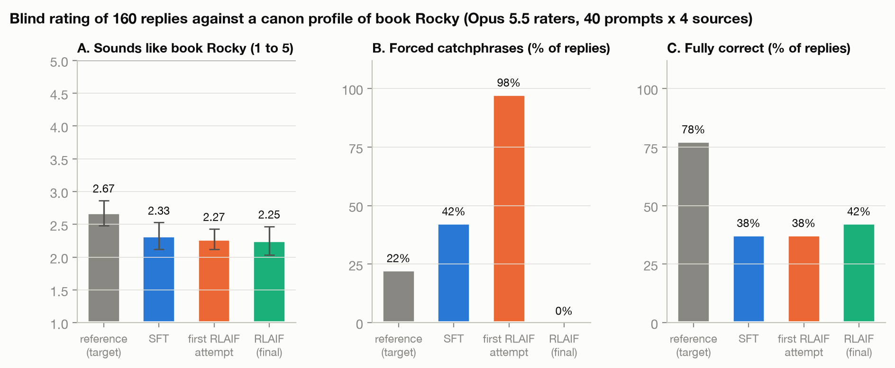
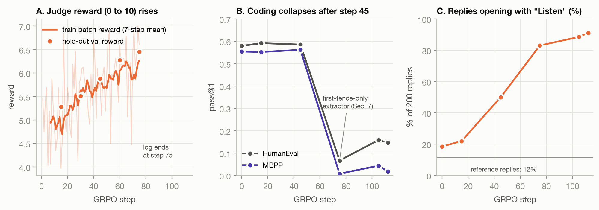

# Rocky on Qwen2.5-3B: Persona and Coding Through SFT, RLAIF and RLVR

**Riddhi Bhagwat, Essa Jan, Daniel Schwartz** · CS 2881R, Assignment 1 · repo `essacheez/Posttraining-coding-rocky`

Final-results draft. All training and code-benchmark results are in. The only outstanding result is the independent AI-judge evaluation of the curriculum RLVR checkpoint.

## Summary

- **Persona:** Rocky, the alien engineer from *Project Hail Mary*. **STEM task:** Python
  code generation, checked by running unit tests (HumanEval, HumanEval+, MBPP).

- **SFT traded coding for persona.** Style match rose from 0.58 to 0.88, and HumanEval+
  fell 16 points. Only 2.1% of our training targets contained a code block, so the model
  learned that Rocky replies are prose and stopped using code blocks.

- **Our first RLAIF attempt hacked the judge with catchphrases.** With the judge as the
  only reward, 91% of replies opened with "Listen. Listen." and HumanEval collapsed,
  while the judge's score kept rising.

- **Final RLAIF improved the persona scores without hurting coding.** A four-part reward
  penalizes overused catchphrases and protects code formatting. It raised style match
  from 0.88 to 0.93 and cut forced catchphrases from 42% of replies to 0%, while coding
  moved less than 1 point. The style gain is modest (95% CI -0.02 to +0.13), and two
  blind reads did not find RLAIF more Rocky than SFT.

- **Our target voice was partly off-canon.** Book Rocky's most frequent habit, ending
  questions with ", question?", appeared in only 10% of our training data. Our
  catchphrase penalty also fired on 58% of our own target replies.

- **Curriculum RLVR recovered most of the lost coding capability while preserving the
  persona.** From RLAIF to the final RLVR checkpoint, HumanEval rose 11.6 points,
  HumanEval+ rose 10.9, and MBPP rose 2.2. Style cosine also increased from 0.930 to
  0.947. The independent AI-judge evaluation of this checkpoint is still pending, so
  model selection remains provisional.

## 1. Setup, and why Rocky

We picked Rocky because he has a very distinctive way of talking, which we expected to
be easy to describe, understand and measure. His voice is mostly grammar: he drops
"the," "a" and "is" ("This plan good."), uses bare verbs, and avoids contractions. That
made it measurable without an AI. Our Rocky text uses "the" 2.5 times per 1,000 words;
base Qwen uses it 62 times. We chose code for the STEM task because running unit tests
is a cheap, trustworthy verifier, and because code is where the persona fits worst.

| | |
| --- | --- |
| Base model / adapters | Qwen2.5-3B-Instruct; LoRA r=32 on all projections at every stage. SFT/RLAIF used TRL + vLLM; the curriculum RLVR run used two L40S GPUs. |
| System prompt | Qwen's default at train and eval time, so the persona has to live in the weights |
| Persona eval | 200 held-out prompts, greedy decoding. **Reference replies** are the held-out answers from our dataset: real human answers rewritten into Rocky's voice by gpt-4o-mini, never trained on. They are our target and the ceiling on every metric. |
| Persona metrics | **Style match**: cosine similarity of function-word, punctuation and rhythm profiles to the Rocky training corpus (no AI involved). **Judge**: five-dimension rubric (independent model); the final curriculum checkpoint is pending and dimensions will be reported separately (Section 6). |
| STEM eval | HumanEval (164), HumanEval+ (same problems, much larger hidden test suites), MBPP test (500); pass@1. A single score on 164 problems has about ±7.6 points of sampling error (95%) |

## 2. Results across stages and attempts

**Figure 1.** Persona (style match) against coding (HumanEval+) through the final
pipeline, with the abandoned first RLAIF attempt as a failure control. SFT moves up and
left: it bought persona with coding. The failed RLAIF run falls off a cliff. The revised
RLAIF objective improves style without further coding loss, and curriculum RLVR moves
up and right, recovering capability while preserving the persona.

| stage | style match | HumanEval | HumanEval+ | MBPP | judge | forced catchphrases* |
| --- | --- | --- | --- | --- | --- | --- |
| base Qwen | 0.583 | **0.762** | **0.738** | **0.588** | available | |
| SFT | 0.879 | 0.555 | 0.506 | 0.556 | available | 42% |
| *first RLAIF attempt, step 75* | 0.781 | 0.067 | 0.061 | 0.008 | | |
| *first RLAIF attempt, step 112 (end)* | 0.816 | 0.146 | 0.134 | 0.018 | available | 98% |
| RLAIF | 0.930 | 0.579 | 0.537 | 0.562 | available | **0%** |
| curriculum RLVR (step 174) | **0.947** | 0.695 | 0.646 | 0.584 | **pending** | |
| reference replies | 0.981 | | | | available | 22% |

*\*Share of replies with forced catchphrases, from the blind canon rater (Section 6).
Every number comes from committed result files. The latest base row is from
`EVALS/results_base/`; SFT and RLAIF are from `EVALS/results_rlaif/`; curriculum RLVR
is from `EVALS/results_rlvr/`. The first-attempt rows used an older code extractor
(Section 7). LiveCodeBench, measured only during SFT, fell from 0.154 (base) to 0.091
(SFT step 70); we did not track it further. The judge status is shown rather than a
single number because its five dimensions should not be collapsed into the style
cosine and the curriculum checkpoint has not yet been judged.*

## 3. SFT: rewrite real answers, and what that cost

We sampled 1,200 human-written conversations (No Robots, Dolly-15k, OASST2), and
gpt-4o-mini rewrote every assistant reply into Rocky's voice. We trained on 1,000 of
them for 3 epochs, with loss on the final reply only, and held out 200. We rewrote real
answers rather than generating new ones so that the questions and the content stay
fixed and only the style changes.

The persona transferred without memorization: 5-gram overlap with the training data was
0.002, the same as for held-out text. It cost 15 to 16 points on HumanEval and
HumanEval+, and 3 on MBPP. Two things drove the loss.

- **The data mix.** Only **21 of 1,000 training targets (2.1%)** contained a code block.
  The model stopped using code blocks even when told "Reply with only a python code
  block." In the SFT eval run, 164/164 base completions used one and 0/164 SFT
  completions did.

- **Terseness.** HumanEval answers shrank from 80 words to 35.

SFT also overused the most noticeable catchphrases: "listen" at 2.9x the reference rate
and "you" at 3.6x. [OPEN] We have not yet split the coding drop into lost formatting
versus wrong logic. That needs per-problem completions, which the harness did not save.

## 4. RLAIF: a four-part reward, and why

We merged the SFT weights and trained a fresh LoRA with GRPO. For each prompt the model
writes 8 answers and is pushed toward the ones that beat their group's average. Training
used 600 prompts not in the SFT set. The judge is gpt-5.4-nano. It scores correctness
(0 to 5) and Rocky style (1 to 5).

| reward | what it measures | weight |
| --- | --- | --- |
| task | judge: is the answer correct | 1.0 |
| style | judge: Rocky voice. Weighted below task because SFT already installed the voice | 0.6 |
| catchphrase penalty | rule: "listen," "you," "yes," "good" above 1.5x the reference rate, plus 0.5 for opening with "Listen" | 1.0 |
| format | rule: exactly one code block on code prompts; no replies over 1.5x the reference length | 1.0 |

**Why the catchphrase penalty exists.** In our first attempt, the judge was the whole
reward, and its prompt described Rocky's catchphrases as desirable habits. The model
learned that the cheapest way to score well was to add them. It also split code across
several blocks to fit in more Rocky prose (Figure 6). So we made overusing catchphrases
cost reward, to force the model to earn the style score through the writing itself. A
reply like "Listen. Listen. Cats and dogs, both good. ... Good, good, good." now takes
the maximum penalty of -2.

We made four other changes at the same time:

- rewrote the judge prompt so it names catchphrases only in hard caps (for example,
  "cap the style score at 3 if the reply opens with 'Listen'")
- added the format reward
- lowered the learning rate
- raised the KL weight tenfold, to 0.04, so it actually holds the model near SFT

**Result.** Style match rose from 0.879 to 0.930. A bootstrap over the 200 prompts gives
a 95% CI of -0.02 to +0.13 on that gain. About half the gain (0.028 of 0.051) comes from
using "you" and "I" less, which the penalty targets directly. The template disappeared:
0% of replies open with "Listen," against 18% for SFT. No coding benchmark moved more
than 1 point.

**Figure 2.** Catchphrase rates relative to the reference replies (1x means the same
rate). SFT overuses them, the first attempt pushes further, and final RLAIF overcorrects.
The "the" row shows the grammar surviving every stage: base Qwen uses "the" 25x as often
as the references, and every trained model stays within about 2x.

**Why it overshot.** The penalty thresholds are rates per 1,000 words, taken from the
reference text as a whole, but they are applied to each reply on its own. That made the
penalty stricter than we intended: **it fires on 58% of our own reference replies**
(mean -0.85). Nothing in the reward pays for using a catchphrase, and the judge caps
repeated ", question?" tags. The cheapest policy was therefore to drop them: "listen"
fell to 0.04x the reference rate, and the question tag to 0.06x. We see this as a
mis-specified penalty that the model optimized faithfully, not as the model hacking
anything. We did not run an ablation, so this explanation is a hypothesis.

## 5. RLVR: executable reward and a benchmark-disjoint curriculum

The final RLVR run starts from the RLAIF adapter and uses a binary executable reward:
the answer must contain exactly one fenced Python block and pass every provided test.
There is no style judge in the RLVR objective. This cleanly asks whether correctness
training can recover code generation without washing out the persona already installed
by SFT and RLAIF.

The curriculum contains **700 problems selected from a 1,700-problem pool**. None come
from HumanEval, HumanEval+, or MBPP. We first sampled eight completions per candidate
problem from the RLAIF model, then selected every easy and medium problem, nearly every
hard problem, no already-solved problem, and 70 very-hard problems. This avoids spending
most updates on tasks that are either already solved or provide no within-group learning
signal. Training ran for 174 steps over two epochs on two L40S GPUs and took 52 minutes.

**Figure 3.** Curriculum composition. Dark bars are the 700 selected problems; light
bars show the full 1,700-problem pool. Difficulty is the RLAIF model's success count
across eight sampled answers.

**Figure 4.** Coding pass@1 through curriculum RLVR. Step 0 is the RLAIF model. The
final checkpoint is best on all three benchmarks, reaching 0.695 HumanEval, 0.646
HumanEval+, and 0.584 MBPP.

| transition | HumanEval | HumanEval+ | MBPP |
| --- | ---: | ---: | ---: |
| base to SFT | -20.7 | -23.2 | -3.2 |
| SFT to RLAIF | +2.4 | +3.1 | +0.6 |
| RLAIF to curriculum RLVR | **+11.6** | **+10.9** | **+2.2** |
| base to curriculum RLVR | -6.7 | -9.2 | -0.4 |

The curriculum run recovers 63% of the HumanEval loss, 54% of the HumanEval+ loss, and
85% of the MBPP loss introduced before RLVR. The remaining errors are usually semantic
near misses: concise code that solves a simpler interpretation of the task. This fits
the data problem upstream: only 34 of the 1,000 SFT answers contain code, and those
answers teach extreme brevity.

The earlier `rlvr` branch also contains verifier-only and multi-objective MBPP-based
experiments. They remain useful ablations, but they expose training asserts to the model
and therefore are not the primary final result. The benchmark-disjoint curriculum is
the cleaner claim: improvement transfers to three held-out benchmark suites that never
supplied training problems.

## 6. Did the AI judge get gamed?

**In our first RLAIF attempt, yes.** The judge's reward rose on held-out validation
prompts while coding collapsed and the replies converged on one template (Figure 6).
This is specification gaming: the model exploited what the judge prompt rewarded.

**In final RLAIF, our persona scores improved, so we checked them with two blind reads.**
Neither reader knew which source wrote each reply, and both included the first attempt
as a known-gamed control.

1. **A teammate** rated 16 replies (4 prompts, each answered by SFT, the first attempt,
   final RLAIF and the reference) for "sounds like Rocky," 1 to 5. Means: reference
   4.25, SFT 3.62, first attempt 3.62, RLAIF 3.38. With 4 replies per source, these
   differences are noise.
2. **A canon-grounded model rater.** One Claude Opus 5.5 agent researched how Rocky
   speaks in the novel and wrote a canon profile. Two more agents rated 160 shuffled
   replies against it (40 prompts x 4 sources). They scored Rocky fidelity and flagged
   **forced catchphrases**: habits dropped in where nothing in the reply calls for them.

**Figure 5.** Blind canon-grounded rating of 160 replies. Paired by prompt:

- the reference beats SFT by 0.35 (95% CI 0.08 to 0.63, Wilcoxon p = 0.02)

- RLAIF minus SFT is -0.08 (CI -0.25 to +0.10)

- the first attempt minus SFT is -0.05 (CI -0.25 to +0.18)

What this shows:

- **The 1-to-5 fidelity score could not detect the hack.** The first attempt scored the
  same as SFT with both readers, while the forced-catchphrase flag caught 98% of its
  replies. A holistic "does this sound like the character" rating, from a person or a
  model, is not a reliable gaming detector. A targeted check is.

- **RLAIF's measurable change is fewer forced catchphrases (42% to 0%).** On overall
  fidelity, the data rules out an RLAIF gain larger than about 0.1 points on the
  5-point scale.

- **Readers disagree about catchphrases.** Our teammate scored catchphrase-heavy replies
  highly, and the canon rater marked the same ones as forced. Agreement was weak
  (Spearman 0.41 over 16 shared replies).

**Our target was partly off-canon.** The canon research found that Rocky's most
frequent habit is ending questions with ", question?". It found no source for "Listen.
Listen." or ", statement.", both of which our rewrite prompt taught.

| share of replies with... | "Listen. Listen." | ", question?" |
| --- | --- | --- |
| SFT training targets | 20% | 10% |
| SFT outputs | 24% | 0% |
| first RLAIF attempt | 91% | 10% |
| RLAIF outputs | 0% | 0% |

Every metric we built measured closeness to our own style spec, and that spec came from
a model's idea of Rocky rather than the book. The rubric judge inherits the same
problem: its `markers` dimension gives credit for "Listen. Listen." and ", statement."
We therefore report its five dimensions separately and lead with `human_plausibility`.
The independent judge has scored the earlier stages and ablations. Its evaluation of
the curriculum RLVR checkpoint is the one outstanding run; until it lands, we do not
claim that the latest checkpoint is the final winner on the full capability/persona
objective. The gap between training-time and independent scores is also a useful signal
of judge gaming and will be reported dimension by dimension rather than as one opaque
aggregate.

**Correctness.** The canon rater judged 78% of reference replies fully correct, against
38 to 42% for every model, with no difference between SFT and RLAIF. The task reward
grades against a single reference answer, and it did not catch errors like attributing
the modern purse to Mary Anderson, who invented the windshield wiper.

*Caveats.*

- The model rater is a Claude model, like our eval judge, so it is a supporting check.
- Each reply was scored by one of two rater agents, and their per-source means differ by
  up to 0.28.
- The human read is one teammate, blind to the source but not to the project.
- Only non-code prompts were rated.

## 7. The first RLAIF attempt, and what else didn't work

**Figure 6.** The first RLAIF attempt, reconstructed from its training log and checkpoint
evals (commit `070e788`, in `main`'s history). (A) Judge reward rose. (B) Coding
collapsed after step 45. (C) The share of replies opening with "Listen" climbed from 18%
to 91%.

That attempt used one summed judge reward, a higher learning rate, a KL weight ten
times smaller, and a judge prompt that listed "Listen. Listen.", "Question.",
"statement." and "friend" as Rocky's habits. Each change in Section 4 fixes one of these.
One caveat: those checkpoints were scored with an older extractor that read only the
first code block, and the model was splitting code across blocks. The drop to 0.07 is
therefore partly a measurement artifact, and its true size is unknown. [OPEN] Re-score
step 75 with the fixed extractor.

Other things that didn't work:

- **Almost no code in the SFT data**, which cost the code-block format (Section 3).

- **A catchphrase penalty stricter than our own target** (Section 4).

- **A style spec built from a model's idea of the character** (Section 6).

- **Evaluation bugs.** HumanEval+ crashed on oversized test files, and git-lfs pointers
  loaded as fake weights until we added a check. vLLM's greedy decoding is not exactly
  repeatable either: two runs of the same model agreed on only 102 of 200 outputs.

## 8. Did persona and capability trade off?

**Only when they shared a channel.** Persona cost coding when the model could sound more
like Rocky by changing how it wrote code: the SFT data had almost no code blocks, and the
first attempt's judge paid for prose inside code answers. In final RLAIF, code format
had its own reward and the KL penalty held the model near SFT, so persona scores rose
and coding held flat. Curriculum RLVR then improved coding and style cosine together.
That does not prove the objectives never conflict (the independent judge result is still
missing), but it shows that executable-reward training need not erase the installed
persona when the RLVR data are benchmark-disjoint and the run begins from the RLAIF
adapter.

**Pre-launch checklist for persona RL (what we would tell another group)**

1. **Score every reward term on your target data before training.** Our catchphrase
   penalty fired on 58% of our own reference replies.
2. **Describe the voice; don't list its tics as goals.** Whatever the judge prompt lists
   becomes the cheapest target.
3. **Log each reward term separately**, so a hack shows up in one curve instead of
   hiding in a sum.
4. **Keep a known-gamed checkpoint as a control in every evaluation.** Our holistic
   ratings scored the hacked model the same as SFT; only a targeted check caught it.
5. **Build the style spec from the source**, not from a model's summary of it.
6. **Reward on hidden tests**, not the asserts shown in the prompt, and read your code
   extractor.

